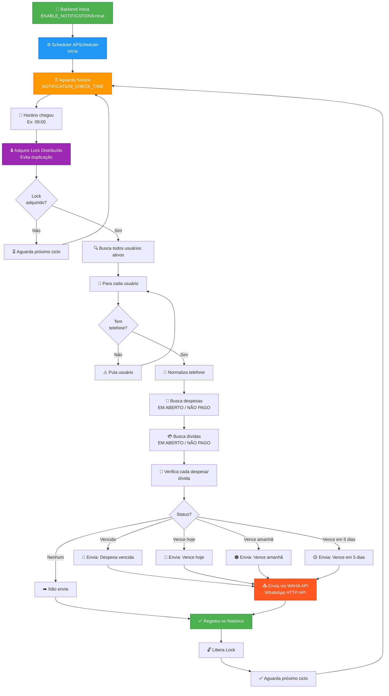

# 💰 Controle de Contas

Sistema completo de gerenciamento financeiro pessoal com suporte a múltiplos usuários, controle de despesas, relatórios analíticos e previsões financeiras.

> 📁 **Versão de portfólio.** Este repositório é uma cópia pública do projeto, que é desenvolvido em um repositório privado. Arquivos de produção (secrets selados, domínios e configurações de infraestrutura real) foram removidos ou substituídos por exemplos.

## 📋 Índice

- [Sobre o Projeto](#-sobre-o-projeto)
- [Funcionalidades](#-funcionalidades)
- [Tecnologias](#%EF%B8%8F-tecnologias)
- [Estrutura do Projeto](#-estrutura-do-projeto)
- [Instalação e Configuração](#-instalação-e-configuração)
- [Uso](#-uso)
- [Scripts e Automação](#-scripts-e-automação)
- [API Endpoints](#-api-endpoints)
- [Screenshots](#-screenshots)
- [Melhorias Implementadas](#-melhorias-implementadas-recentemente)
- [Roadmap Futuro](#-roadmap-futuro)
- [Contribuidores](#-contribuidores)
- [Licença](#-licença)
- [Contato](#-contato)

---

## 🎯 Sobre o Projeto

O **Controle de Contas** é uma aplicação web moderna e responsiva para gerenciamento de finanças pessoais, desenvolvida com as melhores práticas de desenvolvimento full-stack. O sistema oferece uma interface intuitiva com efeitos visuais modernos (glassmorphism, dark mode) e micro-interações para melhorar a experiência do usuário.

### Principais Destaques

- 🎨 **UI/UX Moderna**: Interface com efeitos glassmorphism, animações suaves e micro-interações
- 🔐 **Autenticação Segura**: Sistema completo com JWT, recuperação de senha via email
- 🧭 **Multi-família e Governança**: Escopo por família com papéis `USER`, `USERADMIN` e `USERADMINSUPER`
- 📊 **Relatórios Visuais**: Gráficos interativos e análises detalhadas
- 🔮 **Previsões Inteligentes**: Projeções de 1 a 20 anos, simuladores e alertas de saúde financeira
- 💳 **Gestão de Parcelas**: Controle automático de parcelamentos com barras de progresso
- 🏢 **Logos de Marcas**: Integração com APIs externas (Clearbit/Google Favicons) para exibir logos
- 🎉 **Gamificação**: Efeitos de confete ao marcar despesas como pagas
- 📱 **Responsivo**: Interface adaptada para desktop, tablet e mobile

---

## ✨ Funcionalidades

### 🔑 Autenticação e Usuários

- **Login/Logout**: Sistema de autenticação com tokens JWT
- **Gerenciamento de Usuários**: CRUD completo de usuários (admin)
- **Perfis**: Edição de dados pessoais, foto de perfil e senha
- **Recuperação de Senha**: Reset via email com token temporário
- **Controle de Acesso**: Permissões diferenciadas para admin e usuários comuns
- **Salário por Usuário**: Atualização de salário e dia de pagamento via `PUT /users/me/salary` para enriquecer análises financeiras

#### 👥 Papéis e famílias

- **USERADMINSUPER**: acesso total; cria/edita/deleta usuários e famílias; promove outros superadmins.
- **USERADMIN**: gerencia apenas usuários da própria família; não cria famílias; não cria superadmins.
- **USER**: visualiza/edita apenas a si.

Criando o primeiro superadmin e família:

```bash
cd app/backend
python create_superadmin.py --email SEU_EMAIL --password SUA_SENHA --name "Seu Nome" --cpf 00000000000 --family-name "Familia X"
```

- A família é criada com `_id = CPF` se não existir e o usuário é vinculado.
- Email e CPF são únicos; senha mínima de 6 caracteres.
- Use o papel `USERADMINSUPER` para administrar famílias e usuários.

Regras principais das rotas de usuários:
- **POST /api/users**: superadmin cria em qualquer família (pode informar `family_id`); admin de família cria apenas na própria família e não cria superadmins.
- **GET /api/users**: superadmin vê todos; admin vê apenas a própria família; usuário vê apenas a si.
- **GET/PUT/DELETE /api/users/{id}**: escopo respeita as mesmas regras acima; CPF é imutável.
- **PUT /api/users/me/salary**: qualquer usuário define seu salário mensal e dia de pagamento para os dashboards.

### 🏠 Famílias e Governança

- **CRUD de Famílias**: superadmin cria, atualiza e remove famílias; valida vínculos de usuários antes de remover
- **Escopo Automático**: admins e usuários só enxergam dados da própria família
- **Lista Disponível**: rota `/families/list/available` retorna apenas as famílias que o usuário pode acessar

### 💸 Gestão de Despesas

- **CRUD de Despesas**: Criar, editar, visualizar e deletar despesas
- **Parcelamento Automático**: Criação automática de parcelas (ex: 12x, 24x, 60x)
- **Filtros Avançados**: 
  - Por período (mês/ano ou intervalo customizado)
  - Por status (Pago, Em Aberto, Em Atraso)
  - Por responsável
  - Por categoria
- **Filtro por Intervalo**: uso de `start_date`/`end_date` ISO 8601 para relatórios customizados
- **Categorização**: Organização por categorias (Alimentação, Transporte, Educação, etc.)
- **Forma de Pagamento**: Registro de cartão de crédito, débito, PIX, boleto
- **Notificações WhatsApp**: Alertas automáticos por WhatsApp para despesas próximas do vencimento e vencidas
- **Marcação de Pagamento**: Confirmação com animação de confete e efeito strikethrough
- **Logos Inteligentes**: Exibição automática de logos de marcas (Nubank, Mercado Pago, Shopee, etc.)
- **Barra de Progresso**: Visual de parcelas pagas vs. total (ex: 2/60)

### 📊 Relatórios e Análises

- **Resumo Anual**: Visão geral dos gastos por ano
- **Resumo Mensal**: Detalhamento de despesas por mês
  - Total de despesas
  - Valores pagos e em aberto
  - Comparação por responsável (qualquer membro da família)
- **Gráficos Interativos**: 
  - Evolução mensal com barras empilhadas
  - Separação por status (Pago/Em Aberto)
- **Tabelas Detalhadas**: 
  - Agrupamento de parcelas
  - Expansão de detalhes com visualização individual
  - Paginação customizável (5, 10, 25 itens)
- **Média Mensal**: Cálculo automático da média de gastos
- **Logos nas Listas**: Identificação visual rápida por marca

### 🔮 Previsões Financeiras

- **Estimativas Futuras**: Previsão de despesas baseada em histórico
- **Previsão Longo Prazo (1-20 anos)**: Projeta saldo, dívidas e inflação a partir de renda configurada e média de gastos
- **Simulador de Compras**: Calcula impacto no orçamento por método de pagamento, juros e parcelas
- **Análise de Tendências**: Identificação de padrões de gastos
- **Projeções Mensais**: Estimativa de gastos futuros por mês

### 💳 Controle de Dívidas

- **Registro de Empréstimos**: Gerenciamento de dívidas e empréstimos
- **Parcelamento de Dívidas**: Controle de pagamentos parcelados
- **Histórico**: Acompanhamento de dívidas pagas e pendentes
- **Resumo Total**: Soma, média de juros e custo mensal de juros ativos
- **Planos de Quitação**: Estratégias `SNOWBALL` e `AVALANCHE` via `/debts/payoff-plan`

### 🏦 Controle Financeiro

- **Dashboard Consolidado**: Fontes de pagamento, dependência de crédito e alertas críticos
- **Indicadores**: Saúde financeira (`DANGER` a `EXCELLENT`), score e sugestões automáticas
- **Comparações**: Quebra por usuário (renda configurada) e por fonte de pagamento

### 💰 Gestão de Receitas

- **Receitas Fixas**: Renda recorrente com dia de pagamento configurável
- **Receitas Variáveis**: Renda pontual com data de pagamento específica
- **Filtros por Tipo**: Abas separadas (Todas, Fixas, Variáveis) para visualização
- **Resumo por Pessoa**: Cards mostrando receitas totais, fixas e variáveis por usuário
- **Projeção Automática**: Receitas fixas ativas projetadas para todos os meses
- **Data Flexível**: Dia de pagamento para receitas fixas; data específica para variáveis

### 📈 Gestão de Investimentos

- **Rastreamento por Tipo**: Organização de investimentos por categoria
- **Barras de Progresso Duplas**: Visualização de pagamentos recebidos vs. total + representação no portfólio
- **Parcelamento de Investimentos**: Controle de parcelas pagas (X de Y parcelas pagas)
- **Status Visual**: R$ pagos vs. R$ total por tipo de investimento
- **Dashboard de Investimentos**: 
  - "Seu Investimento" card com total investido, tendência vs. mês anterior e breakdown de status
  - Cards por tipo de investimento mostrando progresso de pagamento
  - "Maior Investimento" destacando o maior investimento ativo
  - Tabela detalhada de lançamentos com datas e status

### ⚙️ Configurações

- **Preferências do Sistema**: Configurações personalizadas por usuário
- **Notificações**: Controle de alertas e lembretes via WhatsApp
- **Temas**: Suporte para modo escuro (preparado para ativação)
- **Email SMTP**: Configuração e teste de envio via `/settings/email` e `/settings/email/test`
- **WhatsApp**: Integração com WAHA para notificações automáticas de contas

---

## 🛠️ Tecnologias

### Backend

- **Framework**: FastAPI (Python)
- **Banco de Dados**: MongoDB (Motor para async)
- **Autenticação**: JWT (python-jose)
- **Segurança**: bcrypt para hash de senhas
- **Validação**: Pydantic
- **Email**: aiosmtplib para envio assíncrono
- **Notificações**: WAHA (WhatsApp HTTP API) para notificações por WhatsApp
- **Middlewares**: CORS, GZip compression

### Frontend

- **Framework**: Next.js 14 (App Router)
- **UI**: React 18 com TypeScript
- **Estilização**: Tailwind CSS
- **Formulários**: React Hook Form + Zod
- **Gráficos**: Recharts
- **Requisições**: Axios
- **Notificações**: React Toastify
- **Animações**: canvas-confetti
- **Ícones**: Lucide React
- **Datas**: date-fns

### DevOps

- **Containerização**: Docker + Docker Compose
- **Gerenciamento de Processos**: PM2 (ecosystem.config.js)
- **Proxy Reverso**: Nginx (configuração não incluída no repo)

---

## 📁 Estrutura do Projeto

```
controle-contas-showcase/
├── app/
│   ├── backend/                      # API FastAPI
│   │   ├── config.py                 # Configurações e variáveis de ambiente
│   │   ├── database.py               # Conexão MongoDB
│   │   ├── main.py                   # Ponto de entrada da API
│   │   ├── models/                   # Modelos Pydantic
│   │   │   ├── debt.py
│   │   │   ├── expense.py
│   │   │   ├── family.py
│   │   │   ├── financial.py
│   │   │   ├── monthly_summary.py
│   │   │   ├── token.py
│   │   │   └── user.py
│   │   ├── routers/                  # Endpoints da API
│   │   │   ├── auth.py              # Autenticação e recuperação de senha
│   │   │   ├── debts.py             # Gestão de dívidas
│   │   │   ├── expenses.py          # CRUD de despesas
│   │   │   ├── financial.py         # Controle financeiro
│   │   │   ├── families.py          # Governança de famílias
│   │   │   ├── reports.py           # Relatórios e análises
│   │   │   ├── settings.py          # Configurações
│   │   │   └── users.py             # Gestão de usuários
│   │   ├── utils/                    # Utilitários
│   │   │   ├── deps.py              # Dependências (auth)
│   │   │   ├── email.py             # Serviço de email
│   │   │   ├── formatting.py        # Formatação de dados
│   │   │   └── security.py          # Hash e verificação JWT
│   │   ├── requirements.txt
│   │   └── Dockerfile
│   │
│   └── frontend/                     # Aplicação Next.js
│       ├── src/
│       │   ├── app/                  # App Router (Next.js 14)
│       │   │   ├── dashboard/        # Dashboard principal
│       │   │   │   ├── expenses/     # Página de despesas
│       │   │   │   ├── financial/    # Controle financeiro
│       │   │   │   ├── predictions/  # Previsões
│       │   │   │   ├── profile/      # Perfil do usuário
│       │   │   │   ├── reports/      # Relatórios
│       │   │   │   ├── settings/     # Configurações
│       │   │   │   └── users/        # Gestão de usuários
│       │   │   ├── login/            # Página de login
│       │   │   ├── forgot-password/  # Recuperação de senha
│       │   │   └── reset-password/   # Reset de senha
│       │   ├── components/           # Componentes React
│       │   │   ├── expenses/
│       │   │   │   ├── BrandLogo.tsx       # Logo de marcas
│       │   │   │   ├── ConfettiEffect.tsx  # Animação de confete
│       │   │   │   ├── ProgressBar.tsx     # Barra de progresso
│       │   │   │   ├── ExpenseFormModal.tsx
│       │   │   │   ├── DeleteConfirmModal.tsx
│       │   │   │   └── PaymentSourceModal.tsx
│       │   │   ├── ExpenseFilter.tsx
│       │   │   ├── PeriodBadge.tsx
│       │   │   ├── PeriodFilter.tsx
│       │   │   └── NotificationProvider.tsx
│       │   ├── contexts/             # Contextos React
│       │   │   └── AuthContext.tsx
│       │   ├── hooks/                # Custom hooks
│       │   │   ├── useCurrencyInput.ts
│       │   │   └── useModal.ts
│       │   ├── lib/                  # Bibliotecas e utilitários
│       │   │   ├── api.ts           # Configuração Axios
│       │   │   ├── cache.ts
│       │   │   ├── categoryUtils.ts
│       │   │   ├── constants.ts
│       │   │   ├── errorHandler.ts
│       │   │   ├── expenseUtils.ts
│       │   │   ├── phoneFormatter.ts
│       │   │   └── utils.ts
│       │   ├── services/             # Camada de serviços
│       │   │   ├── auth.service.ts
│       │   │   ├── debt.service.ts
│       │   │   ├── expense.service.ts
│       │   │   ├── financial.service.ts
│       │   │   ├── notification.service.ts
│       │   │   ├── report.service.ts
│       │   │   └── user.service.ts
│       │   └── types/                # Tipos TypeScript
│       │       └── index.ts
│       ├── next.config.js
│       ├── tailwind.config.js
│       ├── package.json
│       └── Dockerfile
│
├── ecosystem.config.js               # Configuração PM2
└── README.md                         # Este arquivo
```

---

## 🚀 Instalação e Configuração

### Pré-requisitos

- **Node.js** 18+ e npm/yarn
- **Python** 3.10+
- **MongoDB** 4.4+
- **Docker** e Docker Compose (opcional)

### 1. Clonar o Repositório

```bash
git clone https://github.com/dudullsc/controle-contas-showcase.git
cd controle-contas-showcase
```

### 2. Configurar Backend

```bash
cd app/backend

# Criar ambiente virtual
python -m venv .venv
.venv\Scripts\activate  # Windows
# source .venv/bin/activate  # Linux/Mac

# Instalar dependências
pip install -r requirements.txt

# Criar arquivo .env
echo "MONGODB_URL=mongodb://localhost:27017" > .env
echo "DATABASE_NAME=controle_contas" >> .env
echo "SECRET_KEY=sua-chave-secreta-super-segura" >> .env
echo "ALGORITHM=HS256" >> .env
echo "ACCESS_TOKEN_EXPIRE_MINUTES=720" >> .env
echo "FRONTEND_URL=http://localhost:3000" >> .env
echo "ALLOWED_ORIGINS=http://localhost:3000,http://localhost:5173" >> .env
echo "EMAIL_USER=seu-email@gmail.com" >> .env
echo "EMAIL_PASS=sua-senha-de-app" >> .env
echo "EMAIL_FROM_NAME=resetpassword@contas.example.com" >> .env
echo "SMTP_HOST=smtp.gmail.com" >> .env
echo "SMTP_PORT=587" >> .env
echo "SMTP_USE_TLS=true" >> .env
echo "APP_VERSION=1.0.0" >> .env
echo "APP_BUILD=local" >> .env

# Iniciar servidor
uvicorn main:app --reload --host 0.0.0.0 --port 8000
```

### 3. Configurar Frontend

```bash
cd ../frontend

# Instalar dependências
npm install

# Criar arquivo .env.local
echo "NEXT_PUBLIC_API_URL=http://localhost:8000" > .env.local

# Iniciar servidor de desenvolvimento
npm run dev
```

#### Atualizações de Frontend

Para atualizar o frontend em produção:

```bash
cd app/frontend

# Instalar novas dependências (se houver)
npm install

# Build para produção
npm run build

# Reiniciar via PM2 (se configurado)
pm2 restart frontend
# ou com Docker:
docker-compose restart frontend
```

### 4. Usando Docker (Opcional)

```bash
# Na raiz do projeto
docker-compose up -d
```

---

## 📖 Uso

### Primeiro Acesso

1. No backend, crie o superadmin inicial (se ainda não houver): `python create_superadmin.py --email admin@local --password admin123 --name "Admin" --cpf 00000000000 --family-name "Familia Principal"`
2. Acesse `http://localhost:3000`
3. Faça login com o superadmin criado e cadastre usuários/famílias conforme necessário
4. Usuários comuns não recebem privilégios de admin automaticamente

### Criando Despesas

1. Navegue para **Dashboard > Despesas**
2. Clique em **+ Nova Despesa**
3. Preencha os dados:
   - Descrição (ex: "Nubank")
   - Valor
   - Data de vencimento
   - Categoria
   - Forma de pagamento
   - Se é parcelado, informe o número de parcelas
4. Clique em **Salvar**

### Visualizando Relatórios

1. Acesse **Dashboard > Relatórios**
2. Use o filtro de período para selecionar mês/ano
3. Visualize:
   - Gráfico de evolução mensal
   - Tabela de resumo por mês
   - Gastos detalhados por responsável
   - Lista de despesas com logos e parcelas

### Recuperação de Senha

1. Na tela de login, clique em **Esqueceu a senha?**
2. Informe seu email cadastrado
3. Acesse o link recebido por email
4. Defina uma nova senha

---

## 🤖 Scripts e Automação

### Notificações via WhatsApp

O sistema suporta envio de notificações de contas por WhatsApp através do serviço WAHA.

#### Configurar Notificações WhatsApp

1. **Configurar variáveis de ambiente** no `.env`:

```bash
ENABLE_NOTIFICATIONS=true
WAHA_API_KEY=sua-chave-api-waha
WAHA_URL=http://localhost:3000  # URL do servidor WAHA
NOTIFICATION_CHECK_TIME=09:00    # Horário para verificações automáticas
```

2. **Instalar e iniciar WAHA** (WhatsApp HTTP API):

```bash
docker pull devlikeapro/waha:latest
docker run -d -p 3000:3000 \
  -e WAHA_API_KEY=sua-chave-api-waha \
  --name waha \
  devlikeapro/waha:latest
```

#### Enviar Notificações Manuais

Script para enviar notificações de contas do mês atual:

```bash
cd app/backend

# Enviar notificações de contas vencidas/próximas de vencer
python notify_eduardo_valeria.py
```

Este script:
- 📤 Conecta ao MongoDB e WAHA
- 🔍 Encontra contas do mês atual para usuários específicos
- 📱 Envia mensagens personalizadas por WhatsApp
- 🎨 Exibe status com emojis (🔴 vencida, 🟠 vence amanhã, 🟡 vence em 5 dias)
- ✅ Registra total de notificações enviadas

#### Agendar Notificações Automáticas

O sistema já possui um **scheduler automático** integrado no backend (APScheduler). Ele é iniciado junto com a aplicação FastAPI quando `ENABLE_NOTIFICATIONS=true`.

**Como funciona:**

1. No inicializar do backend, o scheduler é ativado (veja `main.py`)
2. Conecta ao serviço WAHA (WhatsApp)
3. Agenda uma verificação diária à hora configurada em `NOTIFICATION_CHECK_TIME` (padrão: 09:00)
4. A cada horário agendado, o serviço `NotificationScheduler` verifica todas as despesas e envia notificações

**Não é necessário:**
- ❌ Kubernetes CronJobs
- ❌ PM2 com cron_restart
- ❌ Scripts manual agendados

Tudo acontece **automaticamente** dentro do próprio backend! 🚀

```bash
# Apenas inicie o backend normalmente
cd app/backend
uvicorn main:app --reload

# Ou com Docker Compose (que já inicia tudo)
docker-compose up -d
```

**Verificar status das notificações:**

```bash
# Ver logs do backend para confirmar scheduler ativo
# Procure por: "✅ Notification Scheduler iniciado para rodar às HH:MM"
```

#### Tipos de Notificações

O sistema envia automaticamente notificações para:

| Evento | Conteúdo | Método |
|--------|----------|--------|
| Despesa **vencida** | Nome, valor, dias em atraso (lembrete **diário** até 30 dias) | `send_notification_expense_overdue()` |
| Despesa **vence hoje** | Nome, valor, data de vencimento | `send_notification_expense_overdue()` |
| Despesa **vence amanhã** | Alerta 1 dia antes | `send_notification_expense_1_day_before()` |
| Despesa **vence em 5 dias** | Alerta prévio | `send_notification_expense_5_days_before()` |

#### Implementar Notificações em Seu Código

```python
from services.whatsapp_notification import WhatsAppNotificationService

# Inicializar serviço
notification_service = WhatsAppNotificationService()

# Testar conexão
is_connected, msg = notification_service.test_connection()

# Enviar notificação de despesa vencida
success, msg = notification_service.send_notification_expense_overdue(
    phone_number="+5531999999999",  # com código de país
    user_name="João Silva",
    expense_description="Nubank",
    amount=350.50,
    due_date=datetime(2026, 2, 10),
    days_overdue=3
)

if success:
    print("✅ Notificação enviada!")
else:
    print(f"❌ Erro: {msg}")
```

#### 📊 Fluxograma do Envio de Notificações



**Como funciona:**

1. ✅ Backend inicia com `ENABLE_NOTIFICATIONS=true`
2. ⚙️ APScheduler inicia e fica aguardando o horário configurado
3. ⏰ No horário agendado (ex: 09:00), começa a verificação
4. 🔒 Adquire um lock distribuído para evitar duplicação (importante em múltiplas instâncias)
5. 🔍 Busca todos os usuários ativos
6. 👤 Para cada usuário, verifica despesas e dívidas
7. 📅 Analisa o status de vencimento
8. 📤 Envia a notificação via WAHA (WhatsApp HTTP API)
9. ✅ Registra o envio no histórico
10. 🔄 Aguarda o próximo ciclo

---

## 🌐 API Endpoints

Prefixo padrão: `/api`

### Autenticação

- `POST /api/auth/login` - Login do usuário (OAuth2 Password)
- `POST /api/auth/forgot-password` - Solicitar reset de senha
- `POST /api/auth/reset-password` - Resetar senha com token

### Usuários

- `GET /api/users/me` - Dados do usuário logado
- `PUT /api/users/me` - Atualizar perfil próprio
- `PUT /api/users/me/salary` - Atualizar salário e dia de pagamento
- `GET /api/users/` - Listar usuários (admin/superadmin)
- `POST /api/users/` - Criar usuário no escopo da família (admin/superadmin)
- `GET /api/users/{id}` - Obter usuário específico (escopo de família)
- `PUT /api/users/{id}` - Atualizar usuário
- `DELETE /api/users/{id}` - Deletar usuário

### Famílias

- `GET /api/families/` - Lista famílias (superadmin vê todas, demais apenas a própria)
- `GET /api/families/{family_id}` - Detalhes da família (escopo aplicado)
- `GET /api/families/list/available` - Famílias disponíveis para o usuário
- `POST /api/families/` - Criar família (superadmin)
- `PUT /api/families/{family_id}` - Atualizar família (superadmin)
- `DELETE /api/families/{family_id}` - Remover família sem usuários vinculados (superadmin)

### Despesas

- `POST /api/expenses/` - Criar despesa
- `GET /api/expenses/?status=&owner_name=&user_id=&month=&year=&start_date=&end_date=&category=&investment_type=` - Listar despesas da família com filtros avançados (período/status/responsável/categoria/tipo de investimento)
- `GET /api/expenses/{id}` - Obter despesa específica
- `PUT /api/expenses/{id}` - Atualizar despesa
- `DELETE /api/expenses/{id}` - Deletar despesa

### Dívidas

- `POST /api/debts/` - Criar dívida
- `GET /api/debts/?status=` - Listar dívidas da família (filtro por status)
- `GET /api/debts/{id}` - Obter dívida
- `PUT /api/debts/{id}` - Atualizar dívida
- `DELETE /api/debts/{id}` - Deletar dívida
- `POST /api/debts/{id}/payment` - Registrar pagamento
- `GET /api/debts/summary/total` - Resumo total de dívidas ativas
- `POST /api/debts/payoff-plan?strategy=&monthly_payment=` - Simular plano de quitação (Snowball/Avalanche)

### Relatórios

- `GET /api/reports/monthly?month=&year=` - Resumo mensal por status, categoria e responsável
- `GET /api/reports/yearly?year=` - Resumo anual com breakdown por status e responsável

### Financeiro

- `GET /api/financial/dashboard?month=&year=` - Dashboard consolidado com saúde financeira e dependência de crédito
- `GET /api/financial/long-term-prediction?years=&current_balance=&inflation_rate=` - Projeção de 1-20 anos com dívidas, inflação e renda
- `POST /api/financial/simulate-purchase?amount=&payment_method=&installments=&interest_rate=` - Simulador de impacto de compra

### Receitas

- `POST /api/incomes/` - Criar receita (FIXED ou VARIABLE)
- `GET /api/incomes/?month=&year=` - Listar receitas da família com filtro de mês
- `GET /api/incomes/{id}` - Obter receita específica
- `PUT /api/incomes/{id}` - Atualizar receita
- `DELETE /api/incomes/{id}` - Deletar receita
- `GET /api/incomes/summary?month=&year=` - Resumo de receitas (total, fixas, variáveis)

- `GET /api/settings/email` - Ver status da configuração de email (admin)
- `POST /api/settings/email` - Atualizar SMTP/email do remetente (admin)
- `POST /api/settings/email/test` - Enviar email de teste (admin)

---

## 🎨 Screenshots

### Dashboard de Despesas
*Interface moderna com glassmorphism, logos de marcas e barras de progresso de parcelas*

### Relatórios Mensais
*Gráficos interativos com análise comparativa de gastos*

### Gestão de Usuários
*Painel administrativo para controle de acesso*

---

## 🔧 Melhorias Implementadas Recentemente

### Sistema de Receitas

- ✅ **Receitas Fixas e Variáveis**: Suporte para FIXED (com payment_day) e VARIABLE (com payment_date)
- ✅ **Data Inteligente**: Seletor de dia (1-31) para receitas fixas; date picker para variáveis
- ✅ **Filtros por Tipo**: Abas para visualizar Todas/Fixas/Variáveis
- ✅ **Cards de Resumo**: Total, Fixas e Variáveis com contadores
- ✅ **Receitas por Pessoa**: Breakdown visual de receitas por usuário da família
- ✅ **Projeção Automática**: Receitas fixas ativas aparecem em todos os meses

### Rastreamento de Investimentos

- ✅ **Progress Bars Duplas**: Mostram progresso de pagamento (X de Y parcelas) + representação no portfólio
- ✅ **Status em Reais**: R$ pagos vs. R$ total para cada tipo de investimento
- ✅ **Dashboard Completo**: Card "Seu Investimento" com tendência, status breakdown (Pagos/Em Aberto/Não Pagos)
- ✅ **Por Tipo de Investimento**: Cards individuais com progresso de pagamento
- ✅ **Maior Investimento**: Destaque do maior investimento ativo
- ✅ **Tabela de Lançamentos**: Detalhes completos com datas, valores e status

### Governança & Multi-família

- ✅ **CRUD de Famílias**: superadmin cria/edita/remove famílias e aplica escopo automático
- ✅ **Escopo Seguro**: todos os recursos de usuários, despesas e dívidas respeitam `family_id`
- ✅ **Cadastro Guiado**: criação de usuários sempre vinculada à família do admin
- ✅ **Tratamento Robusto**: Backend com normalizacão de documentos legados e graceful degradation
- ✅ **Visibilidade por Role**: Abas administrativas (Famílias) apenas para USERADMINSUPER

### Financeiro & Dívidas

- ✅ **Dashboard Financeiro**: dependência de crédito, score de saúde e sugestões automáticas
- ✅ **Previsão Longo Prazo**: projeções de 1-20 anos considerando renda, média de gastos, dívidas e inflação
- ✅ **Simulador de Compras**: avalia impacto por método de pagamento, juros e parcelas
- ✅ **Quitação de Dívidas**: estratégia Snowball/Avalanche com cronograma mensal e custo de juros

### Configuração & UX

- ✅ **Salário no Perfil**: atualização de salário/dia de pagamento via API para comparações entre usuários
- ✅ **SMTP via API**: configuração e teste de email em `/settings/email` e `/settings/email/test`
- ✅ **Filtros por Intervalo**: `start_date`/`end_date` em despesas para relatórios customizados
- ✅ **Emails de Reset**: template revisado e validade de 1 hora
- ✅ **Conformidade PEP8**: Código backend limpo, sem bare except e linhas respeitando limite de 79 caracteres

---

## 📝 Roadmap Futuro

- [ ] PWA (Progressive Web App)
- [ ] Exportação de relatórios (PDF, Excel)
- [ ] Gráficos de pizza para categorias
- [ ] Orçamento mensal por categoria
- [ ] Notificações push
- [ ] Integração com Open Banking
- [ ] App mobile nativo (React Native)
- [ ] Importação de extratos bancários (CSV/OFX)
- [ ] Dashboard personalizável com widgets

---

## 👥 Contribuidores

- **Eduardo** - Desenvolvedor Full Stack

---

## 📄 Licença

Projeto pessoal publicado como portfólio. Todos os direitos reservados.

---

## 🤝 Contato

Para dúvidas ou sugestões, entre em contato através do email configurado no sistema.

---

**Desenvolvido com ❤️ usando FastAPI, Next.js e MongoDB**
